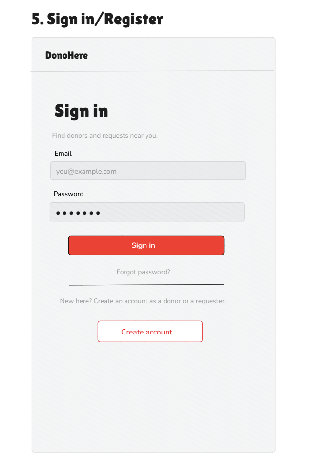

# Project proposal

**Due:** Sunday 8 November 2026 · **Submit:** commit it as `PROPOSAL.md` in the root
of your group's repository and tag that commit `proposal`

Replace every _italic_ instruction with your own text. Keep the whole
proposal under four pages.

---

## 1. DonoHere

An app that helps blood donation services and donors to coordinate and request donations so that the process is more efficient and accessible.

## 2. Group

| Name           | Role                            |
| -------------- | ------------------------------- |
| Liya Belay     | Flutter dev, donor side         |
| Maedot Berhanu | UI/UX + state management        |
| Mahder Kassaw  | Tech lead + backend/API         |
| Siham Tewekel  | QA + docs + notifications       |
| Wangari Dereje | Flutter dev, blood service side |

## 3. The problem

In Ethiopia, blood supply does not keep up with demand. Officials from the National Blood Bank Service say recruiting voluntary, unpaid donors is the main challenge, because low awareness and fear deter people. The country relies heavily on family replacement and paid donors, and the blood bank has declared nationwide shortages during fasting seasons. The shortage matters most for mothers and newborns: Addis Fortune links the lack of safe blood to higher maternal mortality.

Those affected are patients needing transfusions (surgery, accidents, childbirth complications, sickle cell disease, cancer treatment), their families, hospital staff, and willing donors who are never told that someone near them needs their blood type.

Today, a family in Addis Ababa is usually asked to bring replacement donors themselves. They phone relatives and friends or post appeals in Telegram and Facebook groups, while the blood bank relies on text messages to regular donors, media campaigns and mobile collection stations. This works poorly:

- **It is slow and untargeted.** Appeals spread by chance and can go unseen for hours. Most people who see a group post have the wrong blood type, live across the city, or gave blood recently.
- **It is hard to track.** Families cannot tell whether anyone is on the way, so appeals continue after the need is met, and donors cannot tell which requests are still open.
- **It depends on personal networks and is unsafe.** Newcomers such as students and migrants have few contacts and are pushed toward paid donors. WHO notes that replacement and paid donors carry a higher infection risk than repeat voluntary donors.

A mobile app fits because a phone is the one device people carry, so a push notification can reach a matching donor within minutes. It can also capture blood type, location and availability, which lets us filter by distance in a city where a donor ten minutes away is far more useful than one an hour away. And one app serves both sides: donors register once and can be found when needed, while requesters post, track and close a request in one place. This builds the pool of voluntary donors that officials say is hardest to recruit, and it supports the blood bank rather than replacing it.

## 4. Users

- **A real example.** Maereg Kassaw wanted to donate blood but did not know who to contact, and so did not know whether anyone needed their blood type or where to go. That willingness went unused. This is the gap DonoHere closes for donors: Maereg could register a blood type and area once, and requests that match would reach them directly.

- **Donors (primary users).** These are healthy adults in Addis Ababa who are willing to give blood. Many are university students, young professionals and past donors from campus or workplace drives. They need to register their blood type, area and availability quickly, see only open requests that match their type and are near them, and tell the requester they are coming. Usage is occasional but time-sensitive: a few times a week to check requests and update availability, and immediately when a matching request notification arrives.

- **Requesters: patients' families and friends.** These are people who suddenly need blood for someone in a hospital such as Tikur Anbessa, St. Paul's or Yekatit 12. They are stressed, short of time and often asked to find their own donors. They need to post a request fast (blood type, units, hospital, urgency), see nearby donors with a matching type, and mark the request fulfilled. Usage is rare but intense: heavy use for a few hours or days, then little or none. The app must therefore work without any learning, with a short flow, simple wording, and Amharic language support so that people can use it comfortably under stress.

- **Requesters: blood donation services and hospital staff.** These include blood bank coordinators, hospital staff and organizers of donation drives, who regularly need specific blood types or must find donors for particular patients. They need to post requests, see available donors nearby, and receive suggested best matches so they do not check every profile. They are the heaviest users, likely opening the app daily during working hours to post, follow up and close requests.

## Sources

- [Addis Standard: nationwide blood shortage during fasting seasons](https://addisstandard.com/?p=26432)
- [ENA: Low awareness hampering voluntary blood donation in Ethiopia](https://www.ena.et/web/eng/w/en_10564)
- [Addis Fortune: Lifeline lockdown](https://addisfortune.news/lifeline-lockdown)
- [WHO AFRO: Speech at the training workshop on blood donor recruitment](https://www.afro.who.int/pt/node/1120)

## 5. User stories

1. As a donor or requester, I want to register and sign in so that my profile and requests are linked to me. (must)
2. As a donor, I want to create a profile with my blood type, area and availability so that people who need blood can find me. (must)
3. As a requester, I want to post a blood request with blood type, units needed, hospital and urgency so that donors know where help is needed. (must)
4. As a requester, I want to see nearby donors with the matching blood type so that I can reach the right people quickly. (must)
5. As a donor, I want to see open requests near me that match my blood type so that I can choose where to help. (must)
6. As a donor, I want to respond to a request so that the requester knows someone is coming. (should)
7. As a requester, I want the app to suggest the most suitable donors for my request so that I do not have to check every profile. (should)
8. As a requester, I want to mark a request as fulfilled so that it disappears from the active list. (could)

## 6. Screens

| Screen               | Purpose                                              | User stories |
| -------------------- | ---------------------------------------------------- | ------------ |
| Sign in / Register   | Create an account or sign in                         | 1            |
| Home (open requests) | List open requests near me that match my blood type  | 5            |
| Donor profile        | Create or edit blood type, area and availability     | 2            |
| Create request       | Form for blood type, units, hospital and urgency     | 3            |
| Nearby donors        | List or map of matching donors close to a request    | 4, 7         |
| Request detail       | Full request info, respond button, mark as fulfilled | 6, 8         |
| My requests          | Requests I posted and their status                   | 3, 8         |

   **Sketches of the main screens**

   
   
   
    
    

## 7. Data model

### 7.1 Entities and their fields 

 1. User: id, fullName, email, phoneNumber, role, createdAt 
2. DonorProfile:  id, userId, bloodType, area, lastDonation, latitude, longitude, isAvailable, isVisible, updatedAt
3. BloodRequest: id, requesterId, bloodTypeNeeded, unitsNeeded, hospital, latitude, longitude, urgency, status, createdAt
4. RequestResponse: id, requestId, donorId, status, createdAt 

### 7.2 Relationships between entities 

1. One User can have one DonorProfile if they register as a donor. 
2. One User can create multiple BloodRequests. 
3. One DonorProfile can respond to multiple BloodRequests. 
4. One BloodRequest can receive responses from multiple donors.
5. Each RequestResponse belongs to one donor and one blood request. 

## 8. Data sources

### 8.1 Local storage

- **SharedPreferences**: Stores simple application preferences such as selected language, notification preferences, and user settings.

- **Drift**: Stores locally cached data such as recently viewed open blood requests and previously retrieved nearby donor or request listings. This allows users to access previously loaded information when the internet connection is unavailable.

### 8.2 REST API – Custom

- Find nearby donors based on the requested blood type and their availability.
- Find nearby open blood requests that match a donor's blood type.
- Suggest suitable donors based on blood type, distance, and availability.
- Return matching results to the Flutter application.

### 8.3 Firebase

- **Firebase Authentication**: Handles user registration, login, and authentication.
- **Cloud Firestore**: Stores user accounts, donor profiles, blood requests, and donor responses. It also keeps the application's data synchronized across users and devices.

## 9. Device feature and AI feature

### 9.1 Device Features

The Blood Donation Coordination System will use smartphone capabilities to make blood donation requests and coordination faster, easier, and more accessible. The proposed device
features are listed below:

| Device feature              | Purpose in the application                                                                                |
| --------------------------- | --------------------------------------------------------------------------------------------------------- |
| Push notifications          | Notifies donors about relevant blood requests, request updates, confirmations, and appointment reminders. |
| Phone / contact integration | Can help users contact an authorized service or emergency contact, with the user's permission.            |

Expected benefit: These device features can reduce communication delays, improve donor accessibility, and make donation coordination more efficient. Contact access will only be used with user permission.

### 9.2 AI Features

Artificial Intelligence (AI) can support the process of finding potential donors and communicating information to users. The proposed AI feature is:

- **Smart notifications**: Sends relevant requests to potential donors based on their blood group, location, and notification preferences. This helps reduce irrelevant alerts and may improve response rates.

**Safety note**: AI will assist with suggestions and communication only. Donor eligibility, final blood compatibility checks, and all medical decisions must be confirmed by qualified healthcare professionals and established clinical procedures.

## 10. Risks

| Risk | Likelihood | Plan |
|------|------------|------|
| Donors may provide outdated availability or location information. | High | Allow donors to update their profiles and display when their information was last updated. |
| Users' personal information and locations may be exposed. | Medium | Use Firebase security rules and share only approximate donor locations. |
| Internet connection problems may prevent users from accessing nearby donors or requests. | High | Cache previously retrieved information using Drift and notify users when live data is unavailable. |
| REST API or Firebase services may become temporarily unavailable. | Medium | Handle connection errors, retry failed requests, and use cached information when possible. |
| Push notifications require Cloud Functions (which need the paid Blaze plan) which is a cost risk. | Medium | Check Firebase pricing early and consider alternative notification methods or manual notification approach. |
| Backend development depends on one team member, creating a bus-factor risk if that person becomes unavailable. | Medium | Ensure at least two team members understand the backend code, document the setup and implementation, and share knowledge regularly. |

## 11. Milestone plan

| Milestone | Week | User stories complete | What we deliver                                                                                                                                                                                                                                                                                                                                                                            |
| --------- | ---- | --------------------- | ------------------------------------------------------------------------------------------------------------------------------------------------------------------------------------------------------------------------------------------------------------------------------------------------------------------------------------------------------------------------------------------ |
| 1         | 6    | 1–5, and 6 partly     | All seven screens with working navigation and in-memory state: register/sign in, donor profile, create request, home list, nearby donors, request detail and my requests. A test account can move through the whole flow, and requests and donors are held in memory only. Story 6 works as a button that flips a local flag.                                                              |
| 2         | 10   | 1–7                   |  Real data replaces the in-memory state. Firebase Auth for accounts, Firestore for donors and requests, and a REST service for blood-type compatibility and donor matching. Local persistence with `shared_preferences` keeps the signed-in session and last-known lists offline. Location-based nearby donors and the AI donor suggestion (stories 4 and 7) are connected to real records. |
| Final     | 14   | 1–8                   | Story 8 (mark a request as fulfilled) and the notification flow are finished. We add tests for the matching and request logic, polish empty, loading and error states, finish the docs, and prepare the demo.                                                                                                                                                                              |

Work runs in parallel rather than strictly milestone by milestone. Liya
and Wangari build the donor-side and blood-service screens, Maedot keeps
the shared widgets and state management consistent, Mahder builds the
API, Firebase rules and matching logic, and Siham writes tests and docs
and sets up notifications. Each milestone ends with a group review and a
tagged commit, so anything that slips is visible before the next one
starts.

## 12. AI-use plan

Our team intends to use AI developer tools (GitHub Copilot, ChatGPT, and Claude) in accordance with the course policy in `mobile-application-development-course/syllabus/policies.md`:

### 12.1 Intended Uses and Levels

- **Learning and concept explanation (Level 1):** Clarifying unfamiliar Flutter/Riverpod mechanics, asynchronous Dart streams, and Firebase integration patterns.
- **Code review and edge-case detection (Level 2):** Reviewing member-written code before opening pull requests to catch unhandled error states, missing semantics labels, or layout overflow risks.
- **Boilerplate and test scaffolding (Level 3 - Draft and verify):** Generating repetitive boilerplate such as immutable Freezed model definitions, JSON serialization logic, and
  initial mock data for widget tests.

### 12.2 Tasks done without AI (Level 0)

Core business logic (such as donor filtering and compatibility rules), Firebase security rules, and database schemas will be designed and implemented by the team by hand first
before consulting any tool.

### 12.3 Verification and Compliance

- **Verification:** Every AI-generated snippet will be verified line-by-line against the official Flutter documentation and tested against the project's automated test suite before merging.
- **Disclosure:** We will track all significant AI assistance in `AI_USAGE.md` at each milestone, recording the prompt, what was changed, and how it was verified.
- **Security:** In compliance with Rule 5 of `policies.md`, no API keys, Firebase secrets, or personal data will ever be entered into an AI tool.
- **Individual Understanding:** Each member will understand and be able to explain any code in their assigned screens and pull requests during milestone oral checks.

---

## How the proposal is marked (10 points)

| Criterion                                                                                | Points |
| ---------------------------------------------------------------------------------------- | ------ |
| The problem and the users are specific, and one real person who has the problem is named | 2      |
| User stories in the given form, each marked must, should or could                        | 2      |
| The screens and the data model cover every "must" story                                  | 2      |
| Local, REST and Firebase data named, and a device feature and an AI feature chosen       | 2      |
| Risks and the milestone plan are realistic for four people and the course weeks          | 2      |

## Approval

The instructor returns each proposal with one of these decisions and a
short written comment:

- **Approved.**
- **Approved with changes** — the changes are listed; make them before
  Milestone 1.
- **Revise and resubmit by the date given in the comment** — the group may not start
  Milestone 1 work on the parts that must be revised.
